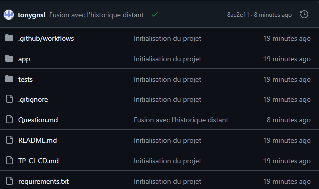

# TP — Découvrir l’intégration continue avec GitHub Actions

## 1. Créer votre projet en local

### Question 1. Quelle est la différence entre git init, git add et git commit ?

git init : Crée le projet Git.\
git add : Sélectionne les changements à sauvegarder. \
git commit : Enregistre la sauvegarde avec un message explicatif. 

## 2. Publier votre dépôt sur GitHub

### Question 2.

**1. Quelle est la différence entre un dépôt local et un dépôt distant ?**

Dépôt local : Le projet sur mon ordinateur, là où je fais mes commits.\
Dépôt distant : Le projet en ligne sur GitHub, pour le sauvegarder et le partager.

**2. À quoi correspond le nom origin ?**
  
origin : C'est le nom du dépôt distant. Il remplace l'URL de GitHub.

**3. Quel est le rôle de la commande git push ?**

git push : Envoie mes commits locaux vers GitHub.

**4. À quoi sert l'option -u dans git push -u origin main ?**

-u : Relie ma branche main locale à la branche main de GitHub. Ensuite, un simple git push suffit.

### Question 3.

**1. Quel est l'intérêt d'un environnement virtuel ?**

Environnement virtuel : Il isole les outils Python du projet (comme pytest). Les versions installées ne gênent pas les autres projets ni le Python de l'ordinateur.

**2. Pourquoi le test de division par zéro peut-il réussir alors que le programme lève une exception ?**

Le test vérifie justement que l'exception est levée, avec pytest.raises. L'erreur est le comportement attendu, donc le test réussit.

## 5. Observer la première CI sur GitHub

### Question 4. Pourquoi le premier push sur main déclenche-t-il automatiquement la CI alors qu'aucune pull request n'a encore été créée ?

Le fichier ci-cd.yml lance la CI à chaque push sur main (on: push: branches: main). Il n'y a pas besoin de pull request pour cela.

## 6. Provoquer une erreur et lire le diagnostic

### Question 5.

**1. Pourquoi le test détecte-t-il la régression ?**

Le test vérifie que add donne le bon résultat. Avec a - b, le résultat obtenu n'est plus celui attendu, donc l'assert échoue.

**2. Que vous apprend le journal que l'icône rouge ne montre pas ?**

L'icône rouge dit seulement que la CI a échoué. Le journal montre en plus le nom du test en échec, la valeur attendue, la valeur obtenue et l'étape qui a planté.

## 8. Bilan

- Le nom de votre dépôt GitHub et son URL.
TP_GitHub-Projects_CI-CD
https://github.com/tonygnsl/TP_GitHub-Projects_CI-CD

- Le nom de la branche principale utilisée.
main

- Une capture d'écran de votre dépôt GitHub contenant l'arborescence du projet.

- Une capture ou le lien vers votre pull request avec le contrôle rouge puis le contrôle vert.

  

- Le nom du test en échec, la cause de la régression et la correction effectuée.

FAILED tests/test_calculator.py::test_add - assert -1 == 5
Pour corriger il  faut remettre a+b

- Une phrase expliquant la différence entre un test exécuté localement et une CI exécutée par GitHub.

Différence entre test local et CI : Un test local est lancé à la main sur mon ordinateur. La CI est lancée automatiquement par GitHub sur une machine propre, à chaque push sur main ou pull request .
